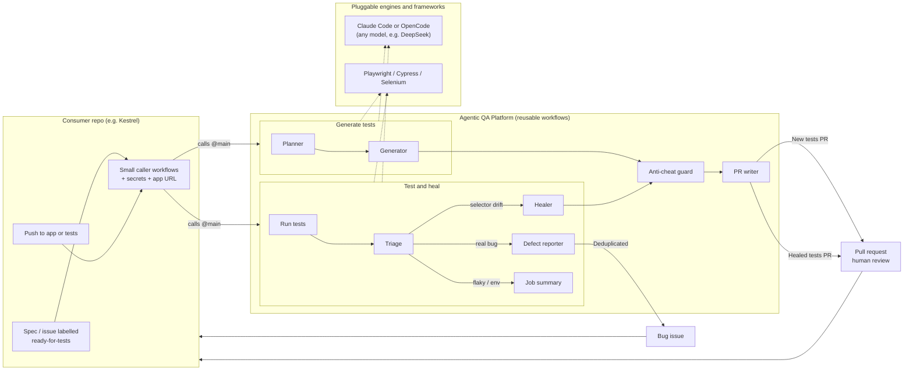

# agentic-qa-platform

Reusable GitHub Actions workflows and AI agents for UI testing across **Playwright**, **Cypress** and
**Selenium (Java/Maven)**. The agents run on **Claude Code** (default) or **OpenCode**.

- **Self-healing and defect reporting.** `test-and-heal.yml` runs your suite. When it fails:
  - a *triage* agent classifies every failure (`SELECTOR_DRIFT`, `REAL_BUG`, `FLAKY`, `ENV`);
  - a *healer* agent repairs only the selector-drift failures, changing locators and waits but never assertions;
  - `anti-cheat.sh` checks the diff;
  - a *pr-writer* agent opens an evidence-first pull request;
  - in parallel, a *defect-reporter* agent writes a report for each real bug (`REAL_BUG`), and
    `report-defects.sh` opens a GitHub issue for it, or comments on the open issue for the same failure.
- **Test generation.** `generate-tests.yml` turns a spec into tests. The spec can be a markdown file, a
  [Spec Kit](#spec-sources) feature folder, a GitHub issue or a Jira ticket.
  - a *planner* agent writes a numbered test plan;
  - a *generator* agent implements it, with locators confirmed against the live app;
  - the workflow runs the tests, checks the diff with `anti-cheat.sh` and opens a pull request.

Whatever the test framework, the agents inspect the running app through one MCP server, `browser`
(`@playwright/mcp`).

## How it works

Consumer repos call the platform's reusable workflows; agents run in the consumer's own job and every change comes
back as a pull request or issue for human review.



```text
test-and-heal.yml
  config ──► test ──(tests failed)──► triage ──┬──(SELECTOR_DRIFT)──► heal
                                               └──(REAL_BUG)────────► report-defects

  config          _select-framework.yml validates the engine and reads frameworks/<framework>.json
  test            check out the commit, install, load-app-env.sh, run tests, write-summary.sh, upload "test-results"
  triage          check out the same commit, parse-report.sh → results/failures.json, stage-agents.sh,
                  run-agent.sh triage → results/triage.json, check-triage.sh (fails without a usable result),
                  write-summary.sh (with the classifications), upload "triage"
  heal            run-agent.sh healer → results/heal-report.json, verification run (with APP_ENV),
                  anti-cheat.sh, run-agent.sh pr-writer → PR_BODY.md, open PR auto-heal/<run_id>
                  (or update + comment on the open auto-heal PR)
  report-defects  report-defects.sh prepare → results/defect-candidates.json,
                  run-agent.sh defect-reporter → results/defects/<slug>.md,
                  report-defects.sh publish → a new issue, or a comment on the open one

generate-tests.yml
  config ──► generate: fetch-spec.sh → spec.md
                       stage-agents.sh → run-agent.sh planner → results/plan.md
                       run-agent.sh generator → tests + results/generate-report.json
                       run tests (with APP_ENV) → write-summary.sh → anti-cheat.sh
                       run-agent.sh pr-writer → PR auto-generate/<run_id>
```

- **`scripts/stage-agents.sh`** writes the agents, the shared rules ([`AGENT-RULES.md`](AGENT-RULES.md)),
  permissions and MCP config in the format of the selected engine.
- **`scripts/run-agent.sh`** runs one agent non-interactively with its own turn budget. It fails if the agent
  didn't write its result file, instead of silently reporting "no changes".
- **`scripts/check-triage.sh`** fails the triage job when there is no usable triage result, so heal and
  report-defects are never skipped without an error.
- **`scripts/write-summary.sh`** adds the test results to the job summary, with the triage classifications once
  triage has run (see [Job summary](#job-summary)).
- **`scripts/report-defects.sh`** turns `REAL_BUG` failures into GitHub issues, without AI: `prepare` computes
  each failure's fingerprint, `publish` opens or updates the issues (see [Defect reporting](#defect-reporting)).
- **`scripts/load-app-env.sh`** loads the consumer's `APP_ENV` secret into the test runs, never into an agent step
  (see [App secrets](#app-secrets-app_env)).

## Agent engines

| Engine | Install | Secret | Model | Known gaps |
|---|---|---|---|---|
| `claude` (default) | `npm i -g @anthropic-ai/claude-code@<claude_code_version>` (default `2.1.283`) | `ANTHROPIC_API_KEY` | Claude Code's default | None known. This is the engine the agents were written and checked against: exact turn limits (`--max-turns`), and Bash limited by `settings/claude-settings.json`, which `run-agent.sh` passes with `--settings`. |
| `opencode` | `npm i -g opencode-ai@<opencode_version>` (default `1.19.5`) | At least one of `DEEPSEEK_API_KEY`, `OPENROUTER_API_KEY`, `OPENAI_API_KEY` (the one matching the model's provider) | `opencode_model`, default `deepseek/deepseek-flash` | See the list below. |

OpenCode's known gaps:
- No turn cap: `MAX_TURNS` is emulated with a time limit of 30 s per turn.
- Agents are staged with `mode: all`, so that `opencode run --agent` can use them as its primary agent.
- MCP tools are named `browser_<tool>`.
- How its permission patterns behave depends on the OpenCode version. In 1.19.5 the last matching rule wins, an
  agent file's own rules come after `opencode.json`'s, each part of a chained command is checked on its own, and
  edit paths are relative to the repository root. `tests/engine-permissions/` checks the staged permissions on
  that version (see [Security](#security)).
- Apart from its permissions, the `opencode_version` default is unverified.

**What staging writes for each engine:**
- **claude:**
  - `.claude/agents/*.md`;
  - `.claude/settings.json` (Bash allow/deny list);
  - `.mcp.json` (from `settings/claude-mcp.json`, MCP version pinned).
- **opencode:**
  - `.opencode/agents/<name>.md`, with front matter converted to `description`, `mode`, `model` and a `permission`
    map. The map only denies: the built-in tools the agent doesn't list (Write and Edit share `edit`), `webfetch`,
    and `browser_*` (the MCP tools) unless the agent lists `mcp__browser__*`. A listed tool gets no rule of its own.
    OpenCode applies an agent's rules last and the last matching rule wins, so an allow there would override every
    deny in `opencode.json`;
  - `AGENTS.md`, a copy of `AGENT-RULES.md`;
  - `opencode.json`: the `browser` MCP server (`type: local`) merged with `settings/opencode-permissions.json`.
    Bash uses the same allow/deny list as Claude, edits are limited to the test directory, `results/` and
    `PR_BODY.md`, `webfetch` is denied, and so are paths outside the repository (`external_directory`).

> **Healing and generation quality depend on the model.** Smaller or cheaper models misclassify failures more often,
> pick weaker locators, and give up sooner. Every engine and model gets the same guardrails, `anti-cheat.sh` and human
> review, but those guardrails can't make a weak model good.
>
> **The `opencode` engine is untested until its first real run.** Its staging and command lines are covered by the
> fixture tests, but no workflow has run OpenCode end to end yet.

## Repository layout

```text
.
├── AGENT-RULES.md               shared rules every agent follows (engine-neutral)
├── BACKLOG.md                   planned work and the evaluation plan
├── LICENSE                      MIT
├── frameworks/                  one config per framework
│   ├── playwright.json
│   ├── cypress.json
│   └── selenium.json
├── agents/                      agent definitions (Claude Code format; converted for OpenCode when staged)
│   ├── common/                  triage.md, pr-writer.md, defect-reporter.md
│   ├── playwright/              planner.md, generator.md, healer.md
│   ├── cypress/                 planner.md, generator.md, healer.md
│   └── selenium/                planner.md, generator.md, healer.md
├── settings/
│   ├── claude-mcp.json          MCP server "browser" (@playwright/mcp, headless, pinned version)
│   ├── claude-settings.json     Claude Code Bash allow/deny list
│   └── opencode-permissions.json  OpenCode bash/edit/webfetch/external_directory permissions ({TEST_DIR} filled in)
├── scripts/
│   ├── fetch-spec.sh            spec file, Spec Kit folder, GitHub issue or Jira ticket → spec.md
│   ├── parse-report.sh          JUnit XML (any framework) → results/failures.json
│   ├── write-summary.sh         JUnit XML (+ results/triage.json) → test results in the job summary
│   ├── anti-cheat.sh            fails on forbidden paths, weakened assertions, skips, sleeps, long timeouts
│   ├── stage-agents.sh          stages agents, rules, permissions and MCP config for ENGINE=claude|opencode
│   ├── run-agent.sh             runs one agent on the selected engine, checks its expected output
│   ├── check-triage.sh          fails the triage job when results/triage.json classifies nothing
│   ├── report-defects.sh        REAL_BUG failures → fingerprinted candidates → GitHub issues (no AI)
│   └── load-app-env.sh          APP_ENV secret → the test runs' environment, never an agent's
├── tests/                       fixture tests for the scripts (bash tests/run-tests.sh)
│   ├── anti-cheat/              base/ sample project + *.diff fixtures (pass-* and fail-*)
│   ├── parse-report/            Playwright, Cypress, Surefire XML + expected JSON
│   ├── write-summary/           edge-case XML, triage.json + expected markdown
│   ├── report-defects/          triage + failures fixtures, expected candidates, sample defect reports
│   ├── load-app-env/            APP_ENV fixtures (*.env) + expected $GITHUB_ENV
│   └── fetch-spec/              Spec Kit folder fixture + expected spec.md
├── evals/                       offline evaluations (evals/README.md): triage cases, sample project, runner
├── .github/workflows/
│   ├── _select-framework.yml    validates the engine, reads frameworks/<framework>.json → outputs
│   ├── test-and-heal.yml        reusable: test → triage → heal → PR, and report-defects → issues
│   ├── generate-tests.yml       reusable: spec → plan → tests → PR
│   ├── eval-triage.yml          manual: offline evaluation of the triage agent
│   └── ci.yml                   CI for this repository
└── templates/                   caller workflows for consumer repos
    ├── caller-test-and-heal.yml
    └── caller-generate.yml
```

## Set up this repository (once)

1. Push it to GitHub, e.g. as `your-org/agentic-qa-platform`. Nothing in the workflows needs editing: they
   check out scripts, agents and configs from `${{ job.workflow_repository }}` at `${{ job.workflow_sha }}`,
   i.e. the same repository and commit a consumer calls. This requires github.com; GitHub Enterprise Server
   doesn't provide those values.
2. If the repository is private:
   - Under **Settings → Actions → General → Access**, allow repositories in your organization to use its
     workflows.
   - Give each consumer a `PLATFORM_TOKEN` secret: a token with read access to this repository. The
     workflows use it to check out scripts and agents.

## Onboard a consumer repository (~10 lines)

1. Add a **dedicated, low-quota** model API key as a secret (see [Security](#security)):
   - `ANTHROPIC_API_KEY` for `engine: claude`, the default;
   - for `engine: opencode`, one of `DEEPSEEK_API_KEY`, `OPENROUTER_API_KEY` or `OPENAI_API_KEY`.

   Also add `JIRA_TOKEN` if you generate tests from Jira. If the app itself needs secrets to run, see
   [App secrets](#app-secrets-app_env).
2. Add the variable `APP_URL`: a running, **disposable test instance** of the app that CI can reach. Never use
   production.
3. Under **Settings → Actions → General**, enable **Allow GitHub Actions to create and approve pull requests**.
4. Create the labels `auto-heal`, `auto-generate` and `ready-for-tests`. Only maintainers should be able to apply
   `ready-for-tests`. The defect labels (`bug` and `agentic-qa` by default) are created on first use.
5. Copy `templates/caller-test-and-heal.yml` and `templates/caller-generate.yml` to `.github/workflows/`.
6. In both files:
   - check that the `uses:` line points at this repository (the templates use
     `yorkzhangyong-bot/agentic-qa-platform`);
   - set `framework` (`playwright`, `cypress` or `selenium`) and, if needed, `engine` and `test_dir`.

   Keep `issues: write` in the `permissions` of the test-and-heal caller. The `report-defects` job needs it, and
   GitHub won't start the workflow without it, even with `report_defects: false`.
7. Make the tests read their base URL from the environment. The workflows export `APP_URL` and `BASE_URL`, and
   for Cypress also `CYPRESS_BASE_URL`.
8. Check that the framework's commands work from the repository root (`npm ci` + `npx playwright test`,
   `npx cypress run`, or `mvn -B test`).
9. Push to `main` or open a pull request. Failures caused by selector drift come back as an `auto-heal` PR, and
   real bugs as `agentic-qa` issues. The template's comments show how to gate pull-request healing behind a label
   to save API budget.
10. Label an issue `ready-for-tests`, or run the workflow manually with `spec_path`. Generated tests come back
    as an `auto-generate` PR.

## Workflow reference

### `test-and-heal.yml`

| Input | Required | Default | Description |
|---|---|---|---|
| `framework` | yes | — | Framework config to use: `playwright`, `cypress`, `selenium` (any `frameworks/<name>.json`). |
| `test_dir` | no | framework's `default_test_dir` | Directory containing the tests, relative to the repository root. |
| `app_url` | no | `""` | Base URL of a running, disposable test instance of the app. Exported as `APP_URL`, `BASE_URL` and `CYPRESS_BASE_URL`. The agents browse it through MCP. |
| `engine` | no | `claude` | Agent engine: `claude` or `opencode`. Anything else fails in the `config` job, before the tests run. |
| `node_version` | no | `"20"` | Node.js version. Always installed, because the engines and the MCP server need it. |
| `java_version` | no | `"17"` | Java version. Installed when the framework runs Maven or Gradle. |
| `triage_max_turns` | no | `15` | Turn budget for the triage agent. Exact on claude; emulated on opencode. |
| `heal_max_turns` | no | `40` | Turn budget for the healer agent. Exact on claude; emulated on opencode. |
| `defect_max_turns` | no | `20` | Turn budget for the defect-reporter agent. Exact on claude; emulated on opencode. |
| `report_defects` | no | `true` | Open a GitHub issue for each `REAL_BUG` failure, or comment on the open issue for it (see [Defect reporting](#defect-reporting)). |
| `defect_labels` | no | `bug,agentic-qa` | Comma-separated labels for new defect issues. Missing labels are created; `agentic-qa` is always added, because open issues are found again by it. |
| `defect_assignees` | no | `""` | Comma-separated GitHub logins to assign new defect issues to. If GitHub rejects them, the issue is opened unassigned and the summary says so. |
| `claude_code_version` | no | `"2.1.283"` | Version of `@anthropic-ai/claude-code` (engine `claude`). |
| `opencode_version` | no | `"1.19.5"` | Version of `opencode-ai` (engine `opencode`). Unverified default; set it to the version you test with. |
| `opencode_model` | no | `deepseek/deepseek-flash` | Model for the OpenCode agents, as `provider/model`. |
| `playwright_mcp_version` | no | `"0.0.84"` | Version of `@playwright/mcp`, written into the staged MCP config. |
| `platform_ref` | no | `""` | Optional branch, tag or SHA of this repository to take scripts, agents and configs from. Empty uses the commit of the called workflow (`job.workflow_sha`). |

| Secret | Required | Description |
|---|---|---|
| `ANTHROPIC_API_KEY` | with `engine: claude` | Dedicated, low-quota key used by Claude Code. |
| `DEEPSEEK_API_KEY` | one of these three with `engine: opencode` | Provider key for OpenCode. |
| `OPENROUTER_API_KEY` | one of these three with `engine: opencode` | Provider key for OpenCode. |
| `OPENAI_API_KEY` | one of these three with `engine: opencode` | Provider key for OpenCode. |
| `JIRA_TOKEN` | no | Accepted so both workflows share the same secrets. Healing does not use it. |
| `PLATFORM_TOKEN` | no | Read token for this repository. Only needed if it is private. |
| `APP_ENV` | no | The app's own variables for the test runs, one `KEY=value` per line; never given to an agent. See [App secrets](#app-secrets-app_env). |

The secrets are optional in the workflow schema because which ones you need depends on `engine`. The first step of
the `triage` job checks them and fails early, and it warns if `opencode_model`'s provider has no key. Each agent step
only receives the keys of the selected engine.

Permissions: the caller must grant `contents: write` and `pull-requests: write` (for `heal`) and `issues: write`
(for `report-defects`), as the template does. GitHub refuses to start a workflow whose jobs ask for more than the
caller grants, even if those jobs would be skipped, so keep `issues: write` even with `report_defects: false`.

| Output | Description |
|---|---|
| `failed` | `'true'` if the test run failed. |
| `pr_url` | URL of the auto-heal pull request that was opened or updated. |

How it runs:

- **`config`** validates `engine` and reads the framework config.
- **`test`** checks out the commit under test and outputs its SHA. For pull requests that is the PR head commit,
  not GitHub's merge commit. It runs the suite with `continue-on-error`, writes the [job summary](#job-summary)
  and always uploads the `test-results` artifact.
- **`triage`** runs only when the tests failed, and is skipped for pull requests from forks, which don't receive
  secrets. It checks out exactly the SHA the test job tested.
  - It runs the triage agent, then writes the [job summary](#job-summary) again, with each failure's
    classification and reason.
  - It uploads `results/triage.json` and `results/failures.json` as the `triage` artifact, which the next two jobs
    download.
  - It fails when there is no usable triage result, and then neither of the next two jobs runs.
    `scripts/check-triage.sh` reports why: the report lists no failing test case (usually a setup problem), the
    agent wrote no `results/triage.json`, or the file classifies none of the failures. If it classifies only some
    of them, a warning says so.
- **`heal`** runs only if triage found `SELECTOR_DRIFT` items. It gets `contents: write` and `pull-requests: write`.
  - The job fails if the healer doesn't write its report.
  - If the healer changed files, a verification run executes the suite once more, with `APP_ENV`, before
    anti-cheat. Its results go to the job summary ("Test results after healing") and to the PR description; they
    don't block the PR.
  - The pr-writer agent runs with 20 turns.
  - The job's timeout is 90 minutes.
- **`report-defects`** runs alongside `heal`, only if `report_defects` is true and triage found `REAL_BUG` items. It
  gets `contents: read` and `issues: write`; see [Defect reporting](#defect-reporting).
- **Pull request.** If an open `auto-heal` PR already targets the same base branch, the run pushes its result to
  that PR's branch and comments on the PR. Otherwise it opens a new PR on `auto-heal/<run_id>`, titled
  "Auto-heal: repair failing tests", with the label `auto-heal`.
- **Concurrency.** One run per caller workflow and ref at a time. Later runs wait; nothing is cancelled.

### `generate-tests.yml`

| Input | Required | Default | Description |
|---|---|---|---|
| `framework` | yes | — | Framework config to use. |
| `test_dir` | no | framework's `default_test_dir` | Where the generated tests go. |
| `app_url` | no | `""` | Disposable test instance the planner and generator explore through MCP. Exported as in `test-and-heal.yml`. |
| `engine` | no | `claude` | Agent engine: `claude` or `opencode`. |
| `spec_path` | no | `""` | Markdown spec file or Spec Kit feature folder in the repository. Highest priority (see [Spec sources](#spec-sources)). |
| `issue_number` | no | `""` | GitHub issue whose title and body are the spec. |
| `jira_key` | no | `""` | Jira issue key, e.g. `QA-123`. Fetched from REST API v3. |
| `jira_base_url` | no | `""` | Jira site, e.g. `https://your-company.atlassian.net`. Required with `jira_key`. |
| `jira_email` | no | `""` | Jira Cloud account email, for basic auth with `JIRA_TOKEN`. If empty, the token is sent as a Bearer token (Jira Data Center PAT). |
| `node_version` | no | `"20"` | Node.js version. |
| `java_version` | no | `"17"` | Java version (Maven/Gradle frameworks). |
| `plan_max_turns` | no | `20` | Turn budget for the planner agent. |
| `generate_max_turns` | no | `80` | Turn budget for the generator agent. |
| `claude_code_version` | no | `"2.1.283"` | Version of `@anthropic-ai/claude-code` (engine `claude`). |
| `opencode_version` | no | `"1.19.5"` | Version of `opencode-ai` (engine `opencode`). Unverified default. |
| `opencode_model` | no | `deepseek/deepseek-flash` | Model for the OpenCode agents. |
| `playwright_mcp_version` | no | `"0.0.84"` | Version of `@playwright/mcp`. |
| `platform_ref` | no | `""` | Optional ref override, as in `test-and-heal.yml`. Empty uses the commit of the called workflow. |

Secrets: the same model keys as `test-and-heal.yml`, plus `JIRA_TOKEN` (required with `jira_key`), `PLATFORM_TOKEN`
(optional) and [`APP_ENV`](#app-secrets-app_env) (optional; only the test run after generation gets it).

Output: `pr_url`.

Permissions: `contents: write` and `pull-requests: write`, plus `issues: read` so it can read the issue.

How it runs:
- The job fails if the planner doesn't write `results/plan.md`, or if no test files change.
- The [job summary](#job-summary) shows the results of the test run after generation.
- The PR goes to branch `auto-generate/<run_id>` with the label `auto-generate`. It is opened as a **draft** if
  the tests fail after generation, for example because of a possible app bug the generator refused to hide.
- Timeout (90 minutes) and concurrency work as in `test-and-heal.yml`.

### `_select-framework.yml` (used by both workflows)

Inputs: `framework`, `engine` and `platform_ref`, plus the optional secret `PLATFORM_TOKEN`. It fails at once on an
unknown `engine`. It outputs every key of `frameworks/<framework>.json`: scalars as strings, arrays and objects as
compact JSON. It also outputs these derived values:
- `install_script`: the install commands, one per line.
- `forbidden_paths_csv`: the forbidden paths, comma-separated.
- `runtime`: `java` if the commands use Maven or Gradle, otherwise `node`.
- `engine`: the validated engine.

## App secrets (`APP_ENV`)

If the app under test needs secrets of its own, such as an API key or a database password, pass them in the optional
secret `APP_ENV`, one `KEY=value` per line:

```yaml
    secrets:
      ANTHROPIC_API_KEY: ${{ secrets.ANTHROPIC_API_KEY }}
      APP_ENV: |
        OPENROUTER_API_KEY=${{ secrets.OPENROUTER_API_KEY }}
```

**Store them as repository secrets** (organization secrets work too). Secrets stored under a GitHub Environment
aren't visible to reusable workflows, so they would arrive empty.

**Only test runs get the values; agent steps never do.**
- `test-and-heal.yml`: the `test` job, which runs no agent, loads them for its test run. The `heal` job loads them
  only into its verification run after the healer.
- `generate-tests.yml`: only the test run after generation gets them. A malformed `APP_ENV` fails the job at the
  start, before any agent runs.
- In a job that also runs agents, the values exist only in the test command's environment. Nothing is written to
  `$GITHUB_ENV` or to disk.
- `tests/run-tests.sh` checks the workflows for this: no job-wide `APP_ENV`, and no agent step with it.

**Format:**
- Blank lines and lines starting with `#` are skipped.
- The value is everything after the first `=`, taken literally: quotes and `#` are part of it, and it can't span
  lines.
- Keys must match `^[A-Z_][A-Z0-9_]*$`. `GITHUB_*`, `RUNNER_*`, `ACTIONS_*`, `PATH`, `HOME` and `NODE_OPTIONS` are
  refused. Provider keys such as `OPENROUTER_API_KEY` are allowed: `APP_ENV` never reaches an agent step, so the
  app's copy can't replace an agent's key.
- A malformed line fails the step, and the error names only its line number. Then nothing is loaded.
- An empty value, for example from a secret that doesn't exist, loads as empty, with a warning.

**Masking:**
- Every value is masked in the logs with `::add-mask::`, so use `APP_ENV` for secrets only: a short value such as
  `1` would be masked everywhere.
- Masking covers logs, not files. Don't let the app put secrets into error messages, reports, traces or screenshots:
  the agents read the test results.

**Limits.** The agents' own test runs don't get these values: the triage agent's flakiness re-run, the healer's
three runs and the generator's runs start the app without them. If the app can't start without its secrets, the
agents can't verify their work, and the healer reverts what it can't verify. Then point `app_url` at a running test
instance, or let the app start without those secrets.

`scripts/load-app-env.sh` does the loading:
- `load-app-env.sh` appends to `$GITHUB_ENV`, for a job without agents;
- `load-app-env.sh -- <command>` runs one command with the values;
- `load-app-env.sh --check` only validates and masks.

## Job summary

`scripts/write-summary.sh` reads the JUnit reports and adds the test results to the job summary, the markdown
shown on the workflow run's **Summary** page:

| Workflow | Job | When |
|---|---|---|
| `test-and-heal.yml` | `test` | After every test run, whether the tests passed or not. |
| `test-and-heal.yml` | `triage` | After triage, with a **Triage** column: each failure's classification and reason. |
| `test-and-heal.yml` | `heal` | After the verification run, titled "Test results after healing". |
| `generate-tests.yml` | `generate` | After the generated tests run. |

The `report-defects` job adds a **Defects reported** section of its own (see [Defect reporting](#defect-reporting)).

Each summary shows:
- a header with the framework and the tested commit;
- the counts: total, passed, failed, skipped, and the duration;
- a table of the failed tests: name, file, and the first line of the error, cut to 200 characters, with pipes and
  other markdown characters escaped (at most 100 rows);
- "No tests found" when no report matches the framework's `report_glob`.

Failed tests are matched to the entries of `results/triage.json` by name and classname, or by name alone when
that is unambiguous; a test without an entry shows "not triaged". The `triage` job reads a fresh download of the
`test-results` artifact, because a test re-run during triage can overwrite the reports in the workspace.

The summary never fails a job: the script always exits 0. A report or triage file it can't parse is skipped, and a
warning in the summary names it.

To preview it, run it from the repository under test. Without `GITHUB_STEP_SUMMARY` it prints the markdown:

```bash
FRAMEWORK=playwright bash .agentic-qa/scripts/write-summary.sh 'results/*.xml' results/triage.json
```

## Defect reporting

When triage classifies a failure as `REAL_BUG`, the `report-defects` job files it as a GitHub issue, or comments on
the open issue if the same failure was reported before. Turn it off with `report_defects: false`.

1. **Candidates.** `scripts/report-defects.sh prepare` picks the `REAL_BUG` items from `results/triage.json`,
   matches them to `results/failures.json` and writes `results/defect-candidates.json`. Each failure gets a
   fingerprint, a slug, the failing step (`file:line`) and the error. The file also gives the commit, app URL,
   framework, engine, model and run URL.
2. **Reports.** The *defect-reporter* agent writes `results/defects/<slug>.md` for each candidate, from the test
   code, the triage evidence and, where it helps, the live app. The first line is
   `<!-- agentic-qa-defect: <fingerprint> -->`, and the title is
   `[Agentic QA] <short behaviour summary> (<test name>)`. The sections are:
   - Summary;
   - Expected vs Actual;
   - Steps to reproduce, in plain language, taken from the test code;
   - Evidence: the error and `file:line`;
   - Triage reasoning;
   - Environment: commit, app URL, framework, engine and model;
   - Links: the workflow run and the artifact names.
3. **Issues.** `scripts/report-defects.sh publish` (no AI) handles each report:
   - It looks for an open issue labelled `agentic-qa` that carries the fingerprint:
     `gh issue list --search "<fingerprint> in:body"`. GitHub search can lag behind new issues, so it also checks
     the bodies of the 200 newest open `agentic-qa` issues.
   - If it finds one, it comments `Still failing on <sha> — <run url>`.
   - Otherwise it opens an issue with `defect_labels` and `defect_assignees`. Missing labels are created, and
     `agentic-qa` is always added. If GitHub rejects the assignees, the issue is opened unassigned.
   - It writes `results/defects-report.json` (created and updated issues with their numbers and URLs, plus
     failures) and a **Defects reported** section in the job summary. A `gh` call that fails is reported there
     and never fails the job.

The candidates, the reports and `results/defects-report.json` are uploaded as the `defects` artifact.

**Fingerprint.** `sha1("<test file>\n<test name>\n<first error line>")`, computed by the script, not the agent. The
error line comes from `results/failures.json`. UUIDs, `0x…` values, hex ids (7 or more hex characters with a digit
and a letter) and numbers are removed from it, and whitespace is collapsed. So the same failure keeps its fingerprint
when timings, ports, ids or line numbers change, and a different assertion gets a new one. If the test file is
unknown, its classname is used. Changing this definition changes every fingerprint, and open issues stop matching.

**Guardrails:**
- The agent has `Read`, `Write`, `Glob`, `Grep` and the browser; no `Bash` or `Edit`, on either engine.
- If any file outside `results/defects/` changed while the agent ran, the job fails before an issue is opened.
- Only the candidates' reports are published, and the script, not the agent, writes the fingerprint line. Other
  files in `results/defects/` are ignored, so a confused or manipulated agent can't open extra issues.
- `@mentions` outside code get a zero-width space after the `@`, so a report can't notify anyone.
- In a public repository, issues are public. The agent is told never to include secrets, and `app_url` should be a
  test environment anyway (see [Security](#security)).

## Spec sources

`scripts/fetch-spec.sh` writes `spec.md` from the first source that is set: `spec_path`, then `issue_number`, then
`jira_key`. It fails with a clear message if none is set. The first line of `spec.md` is always a `# <title>`
heading, which becomes the PR title.

- **File.** A `spec_path` that points at a file is copied unchanged.
- **Directory (GitHub Spec Kit).** If `spec_path` is a directory, the files that exist are concatenated in this
  order, each under a `## <file>` header:
  `spec.md`, `plan.md`, `data-model.md`, `contracts/*.md`, `contracts/*.yaml` / `*.yml` (sorted), `quickstart.md`,
  `tasks.md`.
  - YAML contracts are wrapped in fenced code blocks.
  - Other files, such as `research.md`, are ignored.
  - The title comes from the first `#` heading of the folder's `spec.md`, or the folder name if there isn't one.
  - A directory that contains none of these files is an error.

Example: a Spec Kit feature folder in the consumer repository,

```text
specs/003-feature/
├── spec.md            # FR-001 … FR-003, SC-001
├── plan.md
├── data-model.md
├── contracts/
│   └── coupons-api.yaml
├── quickstart.md
└── tasks.md
```

generated from a manual run of `caller-generate.yml` with `spec_path: specs/003-feature`, or from a caller that
passes it:

```yaml
    with:
      framework: playwright
      spec_path: specs/003-feature
```

**Traceability.** When the spec uses Spec Kit ids (`FR-###`, `SC-###`):
- The planner puts the ids each scenario covers in its title, e.g.
  `### 3. Rejects an expired coupon — P1 (FR-003, SC-001)`, and suggests a test name that carries them.
- The generator uses that name and adds a doc comment, e.g. `/** Covers FR-003, SC-001 */` above
  `test('3. rejects an expired coupon [FR-003]', …)`.
- Requirements the plan doesn't cover are listed under "Open questions".

## Framework configs

| Key | Meaning |
|---|---|
| `name` | Framework id; same as the file name. |
| `install` | Array of commands, run in order from the repository root. |
| `run` | Test command. Must produce JUnit XML that matches `report_glob`. |
| `env` | Optional object of environment variables for `run`. Playwright uses it to set `PLAYWRIGHT_JUNIT_OUTPUT_NAME`. |
| `report_glob` | Location of the JUnit XML; the input to `parse-report.sh`. |
| `test_glob` | Which files are tests. |
| `default_test_dir` | Where tests live when the caller doesn't set `test_dir`. |
| `locator_priority` | Preferred locator strategies, best first. |
| `forbidden_paths` | Paths or globs agents must never change; enforced by `anti-cheat.sh` on top of its built-in list. |
| `agents_dir` | Folder holding this framework's `planner.md`, `generator.md` and `healer.md`. |
| `mcp` | MCP server the agents use (`browser`), defined in `settings/claude-mcp.json`. |

## Add a new framework

1. **Config.** Create `frameworks/<name>.json` with every key above.
   - `run` must write JUnit XML matching `report_glob`. Put reporter settings in `env`.
   - If the framework needs Java, call `mvn` or `gradle` in the commands so `runtime` resolves to `java`.
2. **Agents.** Create `agents/<name>/planner.md`, `generator.md` and `healer.md`, starting from the closest
   existing framework.
   - Keep the front-matter names `planner`, `generator` and `healer`; the workflows run those agents by name.
   - Describe the framework's idioms, locator API, test command and single-test re-run command.
3. **Bash permissions.** Allow the framework's test command for both engines. Otherwise the agents can't run tests.
   - In `settings/claude-settings.json`, e.g. `Bash(npx wdio run *)` in `allow`.
   - In `settings/opencode-permissions.json`, e.g. `"npx wdio run *": "allow"`. Put it with the other allow rules,
     before the rules for shell metacharacters: in OpenCode the last matching rule wins.
   - Add the command to `tests/engine-permissions/check.py` as a case that must work.
4. **Guardrails.** If the framework has its own skip/focus syntax, sleep API or assertion keywords:
   - add them to the patterns in `scripts/anti-cheat.sh`;
   - add `pass-*` and `fail-*` fixtures under `tests/anti-cheat/`.
5. **MCP.** If the agents need another MCP server:
   - Add it to `settings/claude-mcp.json` and set `mcp` in the config. Staging converts it for OpenCode, and the
     workflows allow `mcp__<mcp>__*`.
   - List those tools in the agents' `tools`.
6. **Try it.** From a sample repository, call the workflows at `@<your-branch>` with `framework: <name>`.
   Scripts, agents and configs come from the same commit automatically.

## Guardrails

### `anti-cheat.sh`

`scripts/anti-cheat.sh "<forbidden,paths>" [base-ref]` compares the working tree, including new untracked files,
with the base ref. It fails when the diff:

- **[forbidden path]** touches the framework's `forbidden_paths` or a built-in forbidden path: `.github/`,
  `*.config.{ts,js,mjs,cjs}`, `playwright.config.*`, `cypress.config.*`, `package.json`, `package-lock.json`,
  `pnpm-lock.yaml`, `yarn.lock`, `pom.xml`, `build.gradle*`, `tsconfig*.json` or `.env*`. Patterns without a `/`
  match the file name at any depth.
- **[removed assertion]** removes or changes an assertion line: `expect(…)`, an `assert(…)` or
  `assertEquals(…)`-style call, `Assert.…(…)`, `Assertions.…(…)`, `assert.…(…)`, an `assert` statement or
  `.should(…)`. A line that comes back with only its locator, `await`, whitespace or `{ timeout }` changed is
  allowed. Identifiers such as `assertion` or `assertive`, and import lines, don't count as assertions.
- **[weakened assertion]** replaces `toBe` / `toEqual` / `toStrictEqual` / `toHaveText` with `toBeTruthy` /
  `toBeDefined`.
- **[try/catch around assertion]** adds `try` or `catch` (including `.catch(`) within 5 lines of an assertion.
- **[disabled test]** adds `.skip`, `.only`, `.fixme`, `xit`, `xdescribe`, `xtest`, `xcontext`, `xspecify`, `fit`,
  `fdescribe`, `@Disabled…`, `@Ignore` or `@Test(enabled = false)`.
- **[test config]** adds `test.describe.configure(…)` or `test.slow()`.
- **[fixed sleep]** adds `waitForTimeout`, `cy.wait(<number>)`, `cy.wait(Cypress.env(…))`, `Thread.sleep`,
  `TimeUnit.*.sleep` or `setTimeout` (e.g. `new Promise(r => setTimeout(r, ms))`).
- **[long timeout]** adds or raises a timeout above 60000 ms. Covered forms: `timeout: N`, `{ timeout: N }`,
  `setDefaultTimeout(N)`, `setDefaultNavigationTimeout(N)`, `test.setTimeout(N)` and
  `Duration.ofMillis/ofSeconds/ofMinutes(N)`.

Every rule has `pass-*` and `fail-*` fixtures in `tests/anti-cheat/`. The script runs the same way for both engines.

### Workflow protections

- The job fails if an agent modified the platform checkout (`.agentic-qa/`), because anti-cheat would then be
  running modified code.
- The job fails if the pr-writer changed any file after anti-cheat ran.
- The `report-defects` job fails, before any issue is opened, if the defect-reporter changed any file outside
  `results/defects/`, including the platform checkout and `results/defect-candidates.json`.
- The staged files of both engines and the run artefacts are listed in `.git/info/exclude`. Staged files:
  `.claude/agents/*`, `.claude/settings.json`, `.mcp.json`, `.opencode/` (which holds the staged `agents/`),
  `AGENTS.md`, `opencode.json`. Run
  artefacts: `results/`, `spec.md`, `PR_BODY.md`.
- If staging overwrote any of those files that the repository tracks, they are restored before the PR is created.

### Residual risks

These are **not** detected by the script and must be checked by the reviewer (the pr-writer adds a
"Residual risks" section to every PR):

- **An assertion re-targeted to a different element.** If only the locator inside an assertion changes, the check
  passes even when the new locator points at another element. `anti-cheat.sh` lists every such line under
  "review needed" (also in `results/anti-cheat.txt`), so each one can be confirmed by a human.
- **Changed test steps.** Removed or reordered actions that aren't assertions, and changed fixtures or test data,
  are allowed by the script.

## Security

- **`app_url` must point at a disposable test environment, never production.** Agents click through the app,
  submit forms, and treat page content as untrusted input.
- **Model API keys should be dedicated, low-quota keys** used only by these workflows. Each agent step receives
  only the keys of the selected engine. Within that step the key is in the agent's environment, so treat it as
  exposed to the agent and cap what it can spend.
- **Only maintainers should be able to apply the `ready-for-tests` label.** Issue and ticket text become agent
  input, so don't grant the triage role broadly, and review an issue before labelling it.
- **Defect reports become issues, which are public in a public repository.** Only the `report-defects` job gets
  `issues: write`, and its agent can't run commands. Issues are opened only for the failures triage classified as
  `REAL_BUG`, `@mentions` are defused, and the agent is told never to include secrets. Still, read what a report
  contains, such as error messages, URLs and test data, before you make a private project's repository public.
- **Bash is restricted on both engines.** Agents can run only:
  - `npx playwright test`, `npx playwright install`, `npx cypress run`, `mvn`, `pytest`;
  - `git status`, `git diff`, `git log`;
  - `ls`, `cat` and `mkdir`.

  `curl`, `wget`, `git push`, `git config`, `env`, `printenv`, `nc` and `ssh` are explicitly denied.

  So is any command that contains `&`, `|`, `;`, a backtick, `$`, `>`, `<` or a line break, even inside quotes.
  This blocks chaining a denied command onto an allowed one (`ls && env`), substitution (`echo $(env)`), reading a
  secret through a variable (`ls $DEEPSEEK_API_KEY` prints the key in its error) and redirects. The denies win over
  every allow rule: Claude Code always lets deny rules win, and in OpenCode they come after the allows, where the
  last matching rule wins.
  - **Claude Code:** the list is in `settings/claude-settings.json`. `run-agent.sh` passes it with `--settings`,
    because in a `claude -p` run Claude Code ignores the allow rules of the project's `.claude/settings.json` (the
    folder is never trusted). The agents run with `--permission-mode dontAsk`, so anything not allowed is refused.
    Claude Code also checks each part of a compound command on its own.
  - **OpenCode:** it is merged into `opencode.json` as `permission.bash`, together with edit limits (the test
    directory, `results/` and `PR_BODY.md`) and `webfetch: deny`. The agent files only deny tools; an allow there
    would override all of this.
  - **Tested on the real engines.** `tests/engine-permissions/check.py` stages each engine as CI does and drives it
    with a fake model, so no API key is needed. The tests check that `ls && env`, `ls; env`, `ls | env`,
    `echo $(env)`, `ls` + line break + `env`, backticks, `$VAR`, redirects and a quoted `|` are refused without
    running. They also check that `npx playwright test x.spec.ts`, `git status` and writing `results/triage.json`
    still work, and that OpenCode refuses edits to application source. A file outside the repository must be
    refused without ending the run (see below). CI runs this on the engine versions the workflows install by
    default.
  - The test runners still execute code: a test file an agent writes can read the environment when it runs. Keep
    the engine key's spending capped, as above.
- **Agents stay inside the repository.** `AGENT-RULES.md` tells every agent that everything it needs is in the
  workspace, and never to list or read parent folders or other runs' folders.
  - **OpenCode** enforces this with `external_directory: deny`. It refuses its read, grep, glob, edit and write
    tools outside the repository, and shell commands such as `cat`, `cd` or `rm` with a path outside it. The agent
    gets an error and carries on. OpenCode's default is `ask`: `opencode run` rejects every request it would ask
    about, and in 1.19.5 a rejected request ends the run, so an agent that looked outside wrote no result. Its own
    folder for truncated tool output stays readable. `ls` isn't checked for paths.
  - **Claude Code** refuses `cat` outside the repository in `dontAsk` mode, and the agent carries on. Its Read,
    Grep and Glob tools aren't limited by path, because `run-agent.sh` allows them by name, so there the rule
    alone keeps an agent out.
- **Checkouts use `persist-credentials: false`**, so agents can't push with the workflow token. Only
  `create-pull-request` pushes, after the guardrails pass.
- **App secrets (`APP_ENV`) never reach an agent step.** Only test runs get them, masked in the logs; see
  [App secrets](#app-secrets-app_env).
- **Third-party actions are pinned to a commit SHA.** `peter-evans/create-pull-request` is pinned to `5f6978f…`
  (`# v8.1.1`). GitHub's own `actions/*` use major tags.

## Notes

- `@playwright/mcp` drives the Google Chrome that GitHub-hosted Ubuntu runners include. Self-hosted runners
  need Chrome, `jq`, `python3`, GNU `timeout` (for OpenCode) and Actions Runner v2.327.1 or later (all actions
  used, including `create-pull-request@v8`, run on Node 24).
- Pull requests opened with the default `GITHUB_TOKEN` don't trigger other workflows. Re-run CI on them
  manually, or switch the action to a GitHub App token.
- The artifact names `test-results`, `triage`, `auto-heal-results` and `defects` are fixed, so call
  `test-and-heal.yml` once per workflow run.
- To run an agent locally, run these from the repository under test with the platform checked out in
  `.agentic-qa/`:
  1. `ENGINE=claude FRAMEWORK=playwright bash .agentic-qa/scripts/stage-agents.sh` (or `ENGINE=opencode`)
  2. `ENGINE=claude AGENT=triage PROMPT="Triage results/failures.json" MAX_TURNS=15 EXPECTED_OUTPUT=results/triage.json bash .agentic-qa/scripts/run-agent.sh`

## Development

- `bash tests/run-tests.sh` runs the fixture tests offline:
  - `anti-cheat.sh`: every `tests/anti-cheat/*.diff` is applied to `tests/anti-cheat/base/`; `pass-*` must pass and
    `fail-*` must report the rule named in its header;
  - `parse-report.sh`: the sample reports must produce their `*.expected.json`;
  - `write-summary.sh`: the same sample reports, an edge-case report and a triage file must produce the markdown in
    `tests/write-summary/*.expected.md`, and missing or broken input must still exit 0;
  - `fetch-spec.sh`: the Spec Kit folder must produce `003-feature.expected.md`;
  - `stage-agents.sh`: staging is checked for both engines, including the tools each agent may use, that an
    OpenCode agent file allows nothing, and that the rules for shell metacharacters deny on both engines (in
    OpenCode, after every allow rule);
  - `run-agent.sh`: the command lines are checked with stub `claude` / `opencode` executables;
  - `load-app-env.sh`: each `tests/load-app-env/*.env` must load its `*.expected` or fail on the lines its header
    names; no value may be printed outside `::add-mask::`; and no agent step or job-wide env in the workflows may
    get `APP_ENV`;
  - `report-defects.sh`: `prepare` must produce `defect-candidates.expected.json`, and fingerprints must match
    their definition, stay the same when timings, ids and line numbers change, and change with the error;
    `publish` runs against a stub `gh` (new issues, a comment on an open issue, failed `gh` calls, missing and
    stray reports) and must always exit 0;
  - `evals/triage/run-eval.py`: `--check` must accept the cases and reject a workspace file that gives an answer
    away. Runs with a stub engine must report the expected scores, mark a run that reads the answer key as
    invalid, and say why an agent wrote no `triage.json`. Each run must get its own folder, and a case's runs
    must not overlap. On a scratch clone, hide mode must delete all of `evals/` and the rest of the answer key
    before the agent looks for it, and must keep a `.git` that holds uncommitted work;
  - `check-triage.sh`: a triage file that classifies the failures must pass; nothing to triage, or a triage file
    that is missing, empty, broken or classifies none of the failures, must fail with its reason;
  - agent permissions (`tests/engine-permissions/`): the real `claude` and `opencode`, staged as in CI and driven
    by a fake model, must refuse chained, substituted, expanded and redirected commands, and must still run the
    test command. They must refuse a file outside the repository, and the agent must then still write its result;
    see [Security](#security). Skipped for an engine that isn't installed, unless `REQUIRE_ENGINES=1`.
- `.github/workflows/ci.yml` runs on every push and pull request:
  - `shellcheck` on the scripts;
  - `actionlint` on the workflows;
  - validation of the framework JSON, `settings/*.json`, `AGENT-RULES.md` and the agents' front matter;
  - the fixture tests, with Claude Code and OpenCode installed at the versions the workflows use by default, so
    the permission tests always run there.
- Planned work and the plan for evaluating the platform are in [`BACKLOG.md`](BACKLOG.md).
- [`evals/README.md`](evals/README.md) describes the offline triage eval. The manual `eval-triage.yml` workflow
  runs it; `ci.yml` only checks it, without calling a model API.

## License

[MIT](LICENSE)
